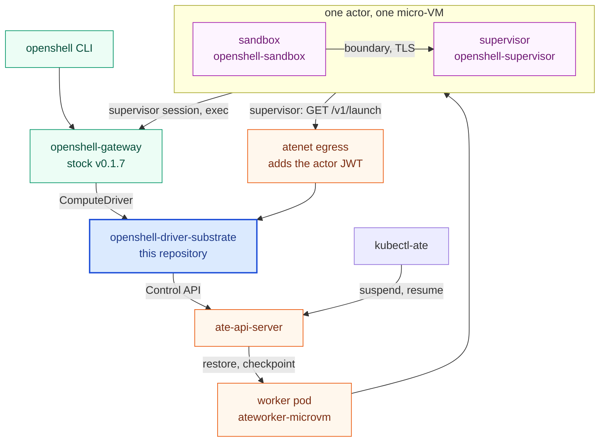

# openshell-driver-substrate

An [Agent Substrate](https://github.com/agent-substrate/substrate) compute
driver for [NVIDIA OpenShell](https://github.com/NVIDIA/OpenShell), plus the
harness to reproduce a working run.

OpenShell's per-request sandbox becomes a Substrate actor, so it can be
snapshotted and resumed instead of cold-started. Stock OpenShell v0.1.7 runs
on Substrate's **micro-VM** sandbox class from upstream `main`, with no patch
to either project. A stock `openshell-gateway` drives the driver over its
socket: `openshell sandbox create` reaches `Ready` in a few seconds, and
`exec`, `logs`, `suspend`, `resume`, `stop`, `start` and `delete` work. The
workload in [`examples/helpdesk`](examples/helpdesk) runs inside a real
OpenShell sandbox, its egress is mediated by the supervisor, and its memory
survives a Substrate suspend and resume. The lifecycle test passes ten times
in a row on arm64 and on amd64.

A resume through the gateway restarts the workload; only a Substrate-side
suspend keeps its memory. See [Known gaps](#known-gaps).

---

## How it fits together

[`docs/architecture.md`](docs/architecture.md) has the full picture: every
component, the lifecycle, and sequence diagrams for create, the request
path, suspend and resume, host death, and how a sandbox gets its credentials.



The driver implements OpenShell's `ComputeDriver` gRPC trait and maps it onto
Substrate's actor lifecycle:

| OpenShell call | What the driver does |
|---|---|
| `create_sandbox` | `CreateActorTemplate` (reused by content hash), `CreateActor`, `CreateActorEgressPolicy`, store the bundle bound to the actor's uid, `ResumeActor` |
| `start_sandbox` | store the bundle of the new generation, clear the stopped mark, `ResumeActor` |
| `stop_sandbox`, `suspend_sandbox` | set the stopped mark, then `SuspendActor` with synchronous durability; `RevertActor` for a `CRASHED` actor |
| `delete_sandbox` | `DeleteActor`, drop the bundle and the mark |
| `get_sandbox` / `list_sandboxes` | `GetActor` / `ListActors`, the actors of `oshl-` templates |
| `watch_sandboxes` | polls `ListActors` every 2 s (Substrate has no watch RPC); suspends again a stopped actor Substrate resumed |
| `ensure_workspace` | `GetAtespace`, then `CreateAtespace` when it is missing |
| `delete_workspace` | no-op: one atespace serves every workspace |

One `ActorTemplate` is reused for every actor whose template comes out
identical, because its name is a hash of the template itself. So only the first
`create_sandbox` for a workload pays for a golden-snapshot build. Nothing that
varies per sandbox goes into a template: a snapshot freezes process memory, so
a per-sandbox value would come back identical in every actor restored from it.
A synthesized template selects its workers by label (`--worker-selector`,
default `workload=openshell-microvm`), and the pool those labels name decides
the sandbox class. Its shape comes from the configuration file (`--config`,
TOML): an ActorTemplate fragment in protojson YAML gives the containers,
volumes, resources and snapshot settings every sandbox gets, and the
request's image goes into the container named `sandbox`; an EgressPolicy
file gives the rules every actor gets before its first resume; `[launch]`
and `[gateway]` say where the launch endpoint listens and which gateway the
supervisors dial. Every container drops all capabilities, the template takes
memory snapshots, and its limits come from the sandbox template's `cpu_limit`
and `memory_limit` (Kubernetes quantities), then the fragment, then the
driver's defaults.

A sandbox gets its credentials after the restore, not from the snapshot. The
gateway mints a launch bundle per sandbox and per start; the driver keeps it
on disk and serves it on `GET /v1/launch/<atespace>/<name>`. Inside the actor
a launcher polls that URL, atenet-egress puts a Substrate-minted actor JWT on
the request, and the driver answers only with that actor's bundle; the
launcher then starts `openshell-supervisor` and `openshell-sandbox` on it,
and the supervisor's session takes the sandbox to `Ready`. The
[Credentials](docs/architecture.md#credentials) section has the checks on
both sides.

The driver registers out of process over a Unix socket, as OpenShell's in-tree
`openshell-driver-podman` / `-docker` / `-kubernetes` / `-vm` binaries do. A
stock gateway picks it up with
`--compute-driver substrate --compute-driver-socket <path>`, or
`compute_driver` and `[openshell.drivers.substrate] socket_path` in its
configuration. No OpenShell fork is involved; `openshell-core` is a plain git
dependency pinned by rev.

`src/`: `lib.rs` (the trait impl), `template.rs` (ActorTemplate synthesis),
`configfile.rs` and `fragment.rs` (the TOML file and its protojson YAML,
decoded with prost-reflect), `bundle.rs` (a bundle from the gateway's launch
authentication), `launch.rs` (the bundle store and the launch endpoint),
`main.rs` (the servers).

## Layout

```
src/                  the driver
proto/                ateapi.proto, used by build.rs
docs/                 architecture, shortcomings
runtime/              the image every workload starts from: the OpenShell binaries and the launcher
examples/helpdesk/    the example workload: a Python agent on the runtime image, and the optional model endpoint
harness/
  gateway/            the gateway and driver pod: Deployment, gateway.toml, driver.toml, the actor fragment, the egress rules, access policy
  manifests/          the WorkerPool
  scripts/prep-host.sh  packages, Docker, Go, kind, kubectl and Rust on Ubuntu 24.04
  scripts/kind-up.sh    Substrate on kind, the pool and the atespace
  scripts/gateway-up.sh the stock gateway and this driver in the cluster, the openshell CLI
  scripts/gateway-test.sh two sandboxes through the gateway, start to finish
  scripts/soak.sh       gateway-test.sh N times in a row
  scripts/render.sh     renders a .tmpl from the environment
```

## Build and test

```sh
cargo build --release
cargo test --lib          # no cluster needed
cargo fmt --all --check
cargo clippy --workspace --all-targets -- -D warnings
```

Needs rustc ≥ 1.94 (OpenShell's floor). The cluster tests are
`harness/scripts/gateway-test.sh` and `soak.sh` below.

`proto/ateapi.proto` is a verbatim copy of Substrate's
`api/ateapi/v1/ateapi.proto` at the commit in `proto/upstream-rev`; CI diffs
the two. To move the pin, which usually means driver changes in the same
commit:

```sh
echo <substrate commit> > proto/upstream-rev
curl -fsSL "https://raw.githubusercontent.com/agent-substrate/substrate/$(cat proto/upstream-rev)/api/ateapi/v1/ateapi.proto" -o proto/ateapi.proto
```

Bumping the OpenShell pin in `Cargo.toml` is not a one-line change:
`src/bundle.rs` builds `BoundaryConfig` and `SandboxRuntimeDescriptor` by
hand and reads the gateway's `SandboxLaunchAuthentication`, and those types
move between releases. Budget that work with every bump.

---

## Reproducing a working run

### 0. A host

A Linux host with **`/dev/kvm`** (nested virtualization if the host is itself
a VM), Ubuntu 24.04 on amd64 or arm64. Each micro-VM worker takes 2 GiB; the
pool below makes two. 16 GB of RAM is the floor, 32 GB is comfortable, and the
clone, the builds and the images want about 30 GB of free disk. Everything
cloned or pulled is public; no credentials are needed. Run every step as the
same user; the walkthrough below assumes root, which is where `prep-host.sh`
installs Rust.

```sh
harness/scripts/prep-host.sh      # packages, Docker, Go, kind, kubectl, Rust; idempotent
```

A host firewall that drops forwarded traffic leaves the kind node with no
egress, and the install then looks like a slow registry. `kind-up.sh` checks
the node's egress before installing anything, and runs `POST_KIND_HOOK` after
the cluster exists so a site script can open the kind bridge. `ufw` in its
default configuration is fine.

### 1. Substrate on kind

```sh
harness/scripts/kind-up.sh
export PATH=${WORK:-$HOME/openshell-substrate}/bin:$PATH   # kubectl-ate, ahead of any older copy
```

One command: it clones Substrate at `SUBSTRATE_REF` (default `upstream/main`)
under `WORK` (default `$HOME/openshell-substrate`, which holds the clone,
`bin/` and `logs/`), builds `kubectl-ate`, creates the kind cluster and its
registry at `localhost:5001`, installs `ate-system` with the micro-VM class
(`ate-setup --kind deploy ate-system --sandbox-classes=microvm`, with the
bundled credential provider), and creates the pool of two micro-VM workers
and the atespace `ate-openshell-microvm`. Steps already done are skipped. The
install log is `$WORK/logs/install.log`. Knobs: `WORK`, `SUBSTRATE_REF`,
`ATESPACE`, `POST_KIND_HOOK`.

Substrate, OpenShell and kata run unmodified. One gap stays: micro-VM
containers run without `no_new_privileges`, and `SecurityContext` has no field
for it, so the launcher in `runtime/` sets it itself.

### 2. Build the example

```sh
REGISTRY=localhost:5001 examples/helpdesk/build.sh
```

This builds the runtime image first (`runtime/build.sh`: the release's
`sandbox` and `supervisor` images mirrored from `ghcr.io/nvidia/openshell`
into the registry, python and the launcher; its digest goes to
`out/runtime.env`), then the helpdesk image on top of it, and writes the
digests to `out/helpdesk.env`. Only this platform's manifest is mirrored, so
build on the architecture the cluster runs. Substrate's API requires image
digests, and Docker's own `RepoDigests` name the upstream index for a
mirrored tag, so the digests come from the registry. Knobs: `REGISTRY`
(required), `OPENSHELL_VERSION`.

### 3. The gateway and the driver

```sh
harness/scripts/gateway-up.sh
```

This puts the release's `openshell-gateway` image and this driver in one pod
in the atespace, as OpenShell's own e2e runs an external driver: the driver
serves `ComputeDriver` on a socket in a shared `emptyDir` and its launch
endpoint on a port, with two Services, `openshell-gateway:17670` and
`openshell-driver:17790`. It builds the driver image from this checkout,
makes the gateway's TLS pair and Ed25519 JWT keys, renders
`harness/gateway/*.tmpl`, the actor fragment and the egress rules among them,
into ConfigMaps, labels the namespace for API access, gives the driver's
ServiceAccount the `editor` role on the atespace, and installs the `openshell`
CLI under `$WORK/bin`. Rerun it after `build.sh` or a driver change:
the pod restarts, its database, its credential key and the driver's bundles
are on volumes, and the supervisors reconnect. Knobs: `WORK`, `REGISTRY`,
`ATESPACE`, `OPENSHELL_VERSION`, `MODEL_HOST`, `MODEL_PORT`.

Then, with a port-forward to the gateway:

```sh
kubectl -n ate-openshell-microvm port-forward svc/openshell-gateway 17670:17670 &
export OPENSHELL_GATEWAY_ENDPOINT=https://127.0.0.1:17670 OPENSHELL_GATEWAY_INSECURE=1
. out/helpdesk.env
MODEL_HOST=ollama.ate-openshell-microvm.svc.cluster.local MODEL_PORT=11434 \
  harness/scripts/render.sh examples/helpdesk/data.yaml.tmpl > policy.yaml
openshell sandbox create --name alice --from "$SANDBOX_IMAGE" --policy policy.yaml --detach \
  -- python3 /opt/helpdesk/agent.py
openshell sandbox get alice            # Ready in 5 to 10 s; 15 to 30 s the first time, for the golden snapshot
openshell sandbox exec alice -- python3 /opt/helpdesk/agent.py chat "my database is timing out"
openshell sandbox exec alice -- python3 /opt/helpdesk/agent.py status      # turns: 1
openshell logs alice
openshell sandbox suspend alice        # the actor is checkpointed and its worker freed
openshell sandbox resume alice         # restored, new credentials, workload restarted
openshell sandbox stop alice && openshell sandbox start alice
openshell sandbox delete alice
```

Without a model endpoint the agent answers on its own. For a real model,
`examples/helpdesk/model-up.sh` deploys Ollama in the atespace, and the create
takes `--env OPENAI_BASE_URL=http://ollama.ate-openshell-microvm.svc.cluster.local:11434/v1 --env HELPDESK_MODEL=qwen2.5:1.5b`.
The policy file matters: without one, the gateway's default Landlock rules do
not cover `/opt/helpdesk` and the workload exits with `Permission denied`.
The `--from` image must be built on the runtime image, as the helpdesk image
is; [`runtime/README.md`](runtime/README.md) has the contract.

### 4. The lifecycle test

```sh
harness/scripts/gateway-test.sh    # about three minutes
harness/scripts/soak.sh 10         # the same, ten times in a row
```

`gateway-test.sh` drives two sandboxes through the gateway: create to Ready,
exec and logs, the egress allow-list, a chat, suspend and resume, stop and
start, a Substrate-side resume behind a stop, a gateway pod restart behind a
stop, a Substrate-side suspend with the memory check, the death of one
sandbox's worker with the gateway's recovery (`stop`, then `start`), delete;
the second sandbox stays untouched until the end. With `WITH_MODEL=1` the
chats go to the model endpoint. `soak.sh` keeps one log per run under
`SOAK_LOGS` (default `$WORK/logs/soak-<time>`).

To tear everything down:

```sh
kind delete cluster && docker rm -f kind-registry && rm -rf "${WORK:-$HOME/openshell-substrate}" out
```

---

## Debugging

### The gates

`openshell-sandbox` runs `qualify_runtime()` before anything else; a failed
gate ends the sandbox, and the worker pod log names it.

| # | Gate | What it needs |
|---|---|---|
| 1 | non-root UID **and** GID | the image's `USER 65532:65532`, which Substrate honors |
| 2 | all five capability sets empty | `capabilities.drop: ["ALL"]`; a non-root process holds none |
| 3 | `no_new_privs == 1` | `launcher.py` runs `setpriv --no-new-privs`, which needs no privilege; Substrate has no field for it |
| 4 | same-UID task-memory probe | nothing; stock kata passes |
| 5 | Landlock allow/deny, ABI ≥ 3 | a writable `/tmp`; Substrate mounts a tmpfs there, and the guest kernel has Landlock |
| 6 | seccomp notification | nothing; stock kata passes |
| 7 | socket virtualization, DNS relay bind on `127.0.0.53:53`, loopback confinement | nothing; Substrate lifts the guest's privileged-port limit |

### The boundary channel

OpenShell refuses a boundary listener on a loopback address and a supervisor
peer whose address is the sandbox's own. The sandbox and supervisor containers
share the actor's network namespace, so the channel runs the other way round:
the supervisor listens on the actor's address, `169.254.17.2:17777`, the same
in every Substrate actor, and the sandbox dials it over TLS
(`RuntimeInitiatedTlsTcp`). The launcher waits for that listener before
starting the sandbox. In the worker pod log, `Runtime-initiated Sandbox
Protocol listener ready` is the supervisor and `Isolation boundary attached`
is the pair.

### The launch endpoint

The launcher's lines in the worker pod log say what it waits for: `launch
endpoint unreachable` while the egress has no policy yet or the Service is
not up, `launch endpoint answered 401` or `403` when the driver refused the
actor JWT (the driver's log says why), and `generation <id> (epoch N)
published` when the files are in place. The driver logs `bundle
handed out` for each delivery. A supervisor that dies logs its reason just
before `the supervisor exited`; the SSH relay's socket, for example, must sit
on the container's own filesystem, because a durable dir takes no Unix
socket. After `the supervisor exited` or `openshell-sandbox exited` the
container is gone, nothing restarts it, and the actor stays `RUNNING` around
it; delete the sandbox.

### DNS

The sandbox answers the workload's DNS at `127.0.0.53` and its broker refuses
any other nameserver. Substrate writes the actor gateway into `/etc/resolv.conf`
in the rootfs base layer and keeps the actor's own edits, so the launcher
replaces the file with `nameserver 127.0.0.53` on the first boot and the golden
snapshot carries it; the image's `/etc` belongs to the sandbox user so no root
is needed. The supervisor keeps its own container, because its policy DNS
resolves upstream names through the container's resolver. The supervisor's
policy DNS then resolves only the hosts the policy names; a refused name shows
as `NET:REFUSE ... policy_dns_ineligible`.

### Two transient conditions

`kubectl-ate delete actor-template` returns `Aborted: another operation is in
progress` while that template's golden warm-up runs. Retry after it finishes.

The golden snapshot is taken when every container's wakeup probe answers
200 (`/healthz` on the two launchers); a probe that never answers fails the
golden actor after 30 s and the template records the error, so
`create_sandbox` fails instead of snapshotting a dead container.

### Where the output is

The worker pod forwards actor logs, each line labelled with the actor and
container; `kubectl-ate logs actor <name> -a <atespace>` filters them, and
`gateway-test.sh` prints the matching lines when a step fails:

```sh
kubectl logs -n "${ATESPACE}" <worker-pod> | grep -i openshell
```

`Isolation boundary attached` and `PROC:LAUNCH` say the supervisor reached the
sandbox and started the workload.

---

## Known gaps

[`docs/shortcomings.md`](docs/shortcomings.md) lists what the driver, the
launcher and the harness do not do, and which of it needs a change in
OpenShell or Substrate. The two that matter most: a resume through the
gateway restarts the workload, and only an image built on the runtime image
runs.

## License

Apache-2.0. See [LICENSE](LICENSE).
