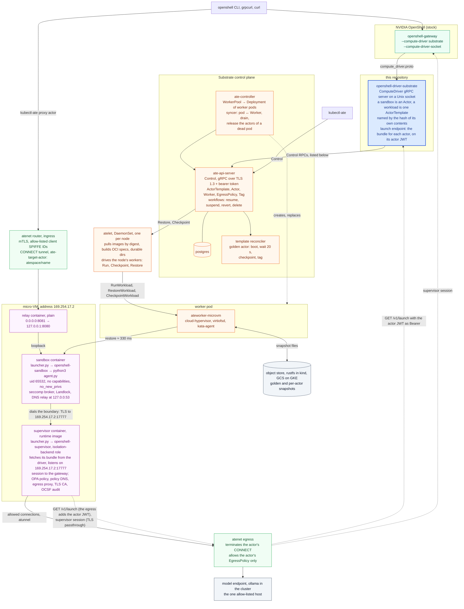
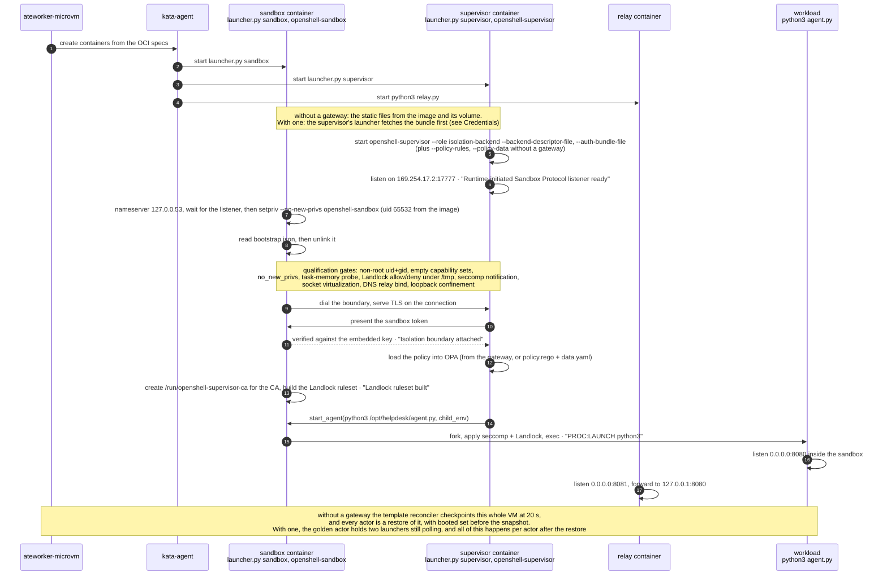
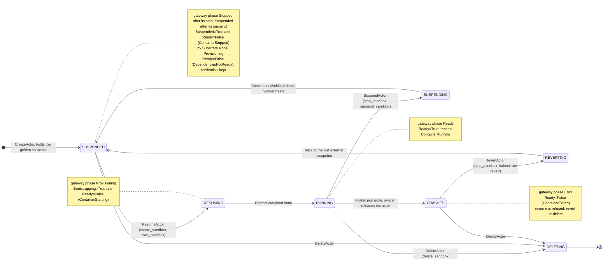
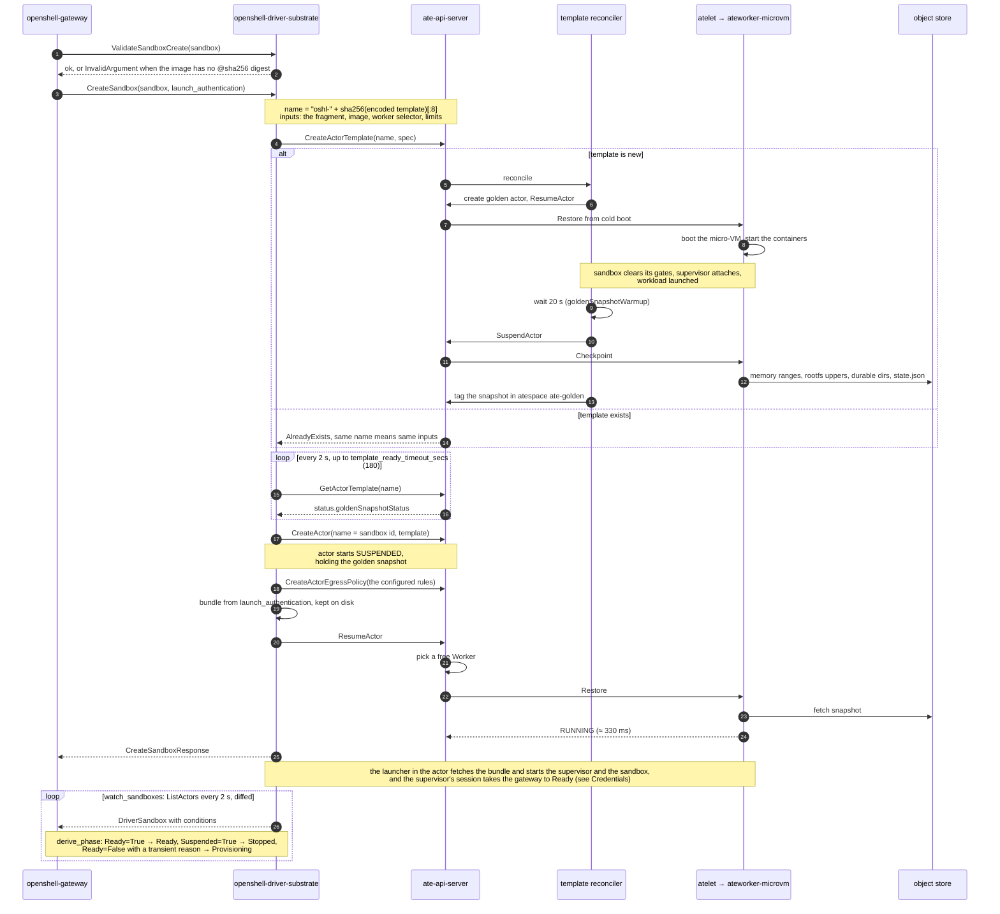
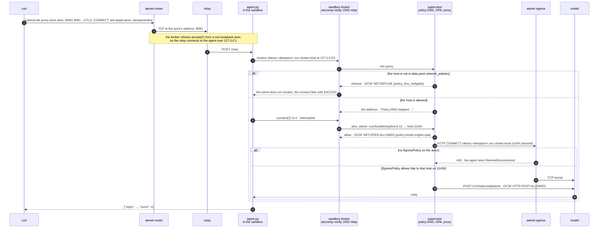
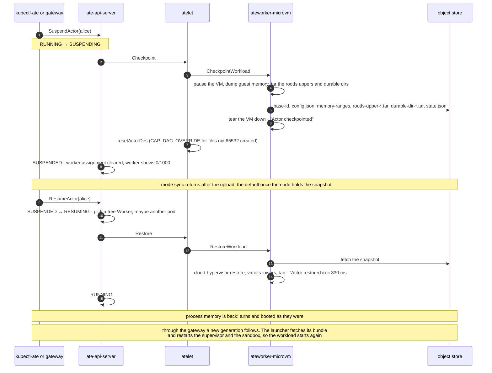
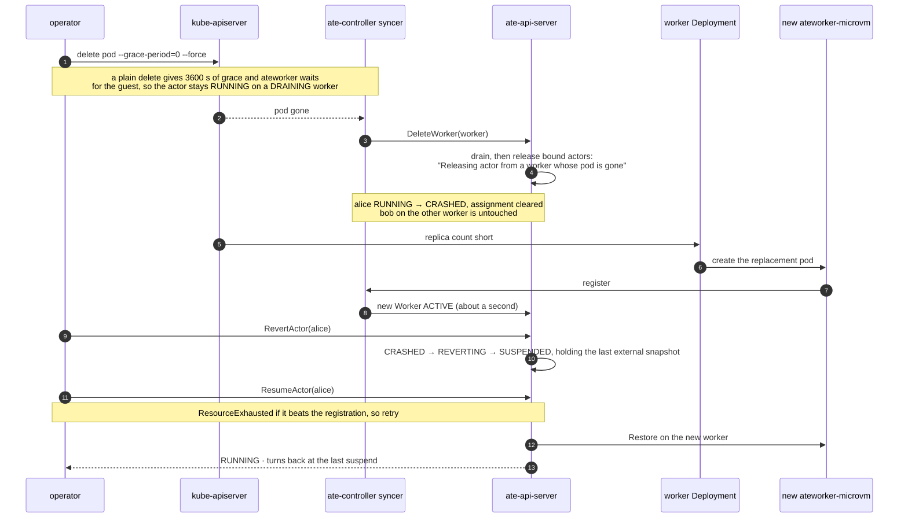
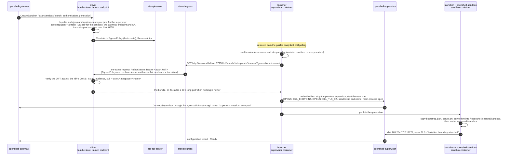

# Architecture

How an OpenShell sandbox becomes an Agent Substrate actor, what runs where,
and what each piece trusts.

## In one paragraph

OpenShell's gateway creates and drives sandboxes through a `ComputeDriver`
gRPC contract. This repository is one such driver, running as its own process
on a Unix socket. It maps each gateway call onto Substrate's `Control` API
(`substrate.ateapi.v1`): a sandbox is an `Actor`, a workload is one
`ActorTemplate`, and starting a sandbox is a restore of that template's golden
snapshot into a micro-VM. Inside the VM, stock OpenShell binaries run
unmodified: `openshell-sandbox` holds the workload, `openshell-supervisor`
enforces policy and audits, and a small relay container makes the workload
reachable through Substrate's ingress. A launcher in the image fetches each
sandbox's gateway-minted credentials from the driver after the restore, so
one golden snapshot serves every sandbox and a stock gateway takes one to
`Ready`. Nothing in OpenShell, Substrate, the guest kernel or kata is forked
or patched; the one gap the demo image works around, `no_new_privs`, is in
[shortcomings.md](shortcomings.md) with the rest.

## The big picture

Colors: green is stock OpenShell, blue is this repository, orange is
Substrate, purple is inside the guest, light green is Substrate's network edge.

Three trust domains meet here:

| Domain | Runs | Trusts |
|---|---|---|
| OpenShell gateway and this driver | one pod in the atespace (`harness/scripts/gateway-up.sh`), or the driver alone on a host | `ate-api-server` over TLS with a bearer token whose audience is `api.ate-system.svc`; the IdP's JWKS for the actor JWTs on the launch endpoint |
| Substrate control plane and node agents | namespace `ate-system`, one atelet per node, one ateworker per worker pod | Kubernetes RBAC, image digests, the object store |
| The guest | one micro-VM per actor | its own kernel and cloud-hypervisor; inside it, the sandbox trusts only the gateway keys in its bootstrap, and the supervisor the gateway's CA from its bundle |

## Components

### openshell-gateway, stock

With `--compute-driver-socket`, the gateway binds the name given to
`--compute-driver` to that socket, whether or not a built-in driver has the
same name. The gateway keeps
the sandbox catalog, mints the per-sandbox launch credentials, and derives a
sandbox's phase from the conditions the driver reports (`derive_phase`):
`Ready=True` is Ready, `Suspended=True` without `Ready=True` is Stopped, a
`Ready=False` with a reason on its transient allowlist is Provisioning, and
one with any other reason is a sticky Error. Provisioning has 1800 s to
reach the supervisor's first report and 300 s after it to reach Ready
(`ProvisioningTimedOut`); after Ready there is no deadline.

### openshell-driver-substrate, this repository

`src/main.rs` parses flags (or `SUBSTRATE_*` and `OPENSHELL_*` environment
variables), loads the configuration file (`--config`: the ActorTemplate
fragment, the egress rules, the `[launch]` endpoint and the `[gateway]` the
supervisors dial; `src/configfile.rs`, protojson YAML decoded in
`src/fragment.rs`), binds the socket, serves `ComputeDriverServer` with
reflection, and the launch endpoint when configured.

`src/lib.rs` implements the trait:

| ComputeDriver call | What the driver does |
|---|---|
| `get_capabilities` | Checks the gateway's extension metadata, names itself `substrate` and advertises `openshell.compute.suspend-resume`; `gateway_manages_lifecycle`, `supports_sandbox_authentication` and `driver_reports_runtime_readiness` are false; CPU and memory limits are supported, GPUs are not. |
| `validate_sandbox_create` | Requires `spec.template.image` with an `@sha256:` digest (ate-api-server rejects an unpinned image; the check saves a round trip) and resource limits that parse as Kubernetes quantities; rejects GPU requests and `user_namespaces`, and `spec.command` when there is no launch endpoint to carry it. |
| `create_sandbox` | Names the template, `ensure_ready` (below), `CreateActor` (an `AlreadyExists` for an actor of the same template is a retried create and is fine), `CreateActorEgressPolicy` with the configured rules (before the first resume: the egress caches a missing policy), the bundle from `spec.launch_authentication` into the store, `ResumeActor`. |
| `start_sandbox` | The bundle of the new generation into the store, `ResumeActor`. |
| `stop_sandbox`, `suspend_sandbox` | `SuspendActor` with synchronous durability: checkpoint, upload, free the worker, keep the snapshot. A `CRASHED` actor gets `RevertActor` instead, back to its last snapshot. |
| `delete_sandbox` | `DeleteActor`; Substrate deletes from any state. The bundle is dropped. The template stays; other actors may share it. |
| `get_sandbox`, `list_sandboxes` | `GetActor`; `ListActors` walked to the last page (1000 per page), keeping the actors of `oshl-` templates. The gateway's name for a sandbox comes from its bundle; the actor is named by the sandbox id. |
| `watch_sandboxes` | Substrate has no watch RPC. The driver polls `ListActors` every 2 s, diffs against the last snapshot, and emits changed and deleted sandboxes. It stops when the gateway drops the stream. |
| `ensure_workspace` | `GetAtespace`, then `CreateAtespace` when it is missing, for the one configured atespace. The trait carries workspace identity only on create, so one atespace serves every workspace. |
| `delete_workspace` | No-op. |
| `authenticate_sandbox` | Unimplemented. |

One `Control` channel is dialed lazily and reused. An interceptor adds
`Authorization: Bearer` from a token file read on every client build, so a
rotated projected token needs no restart. TLS is on when a CA bundle is
configured; a client certificate is optional and must come as a pair.

Conditions are the driver's only voice to the gateway, so `actor_state_conditions`
is written against the gateway's phase rules and pinned by a table test:

| Actor state | Conditions reported | Gateway phase |
|---|---|---|
| RUNNING | `Ready=True` (ContainerRunning) | Ready |
| RESUMING, REVERTING | `Bootstrapping=True`, `Ready=False` (ContainerStarting) | Provisioning; `Bootstrapping=True` is what lets a Stopped sandbox start |
| SUSPENDING, after the gateway's stop or suspend | `Suspended=False` (PodTerminating, the reason the gateway reads as a stop in flight) | Provisioning |
| SUSPENDED, after the gateway's stop or suspend | `Suspended=True`, `Ready=False` (ContainerStopped) | Stopped, or Suspended after the gateway's own suspend, which its lifecycle controller keeps |
| SUSPENDING, SUSPENDED, by Substrate alone | `Ready=False` (DependenciesNotReady) | Provisioning: the gateway keeps the credentials, and the supervisor's return after a Substrate resume makes it Ready again |
| CRASHED | `Ready=False` (ContainerExited) | Error, on purpose: it needs `RevertActor` |
| DELETING | `Ready=False` (ContainerStopped); the status `deleting` flag is set | Deleting |

The stopped mark is set when `SuspendActor` returns, so during the gateway's
own stop the watch sees the Substrate-side row; the gateway ignores snapshots
while Stopping. [shortcomings.md](shortcomings.md) has what that costs when a
stop is cut short.

### Template synthesis, `src/template.rs`

Everything the golden snapshot depends on goes into the template, and nothing
else: the fragment, the image, the worker selector, and the resource limits
(the sandbox template's `cpu_limit` and `memory_limit` as Kubernetes
quantities, the fragment's, or the driver's defaults). The request's
environment stays out: the bundle carries it to the workload. The template
is encoded with prost, its metadata blanked, and hashed; the name is `oshl-`
plus the first eight bytes of the SHA-256. Two sandboxes with the same inputs
share one template and one golden snapshot. Any change to what the template
contains gets a new one.

Nothing per sandbox may be in a template. A snapshot freezes process memory,
so a per-sandbox value baked into it would come back identical in every actor
restored from it. The sandbox id and the gateway-minted token are left out for
that reason, and a test asserts it. The per-sandbox part arrives after the
restore; see [Credentials](#credentials).

The shape comes from the configuration file's fragment: its containers
replace the synthesized one, the container named `sandbox` takes the
request's image, and volumes, snapshot settings and limits
come from the fragment when it sets them. A fragment may not name the
template, pick the pool or add a capability. The harness fragment is three
containers (sandbox, supervisor, relay), two durable dirs and the identity
volume; the demo's adds the supervisor's files volume for the run without a
gateway. Without a fragment the template is one container. Either way every container drops all
capabilities (`openshell-sandbox` refuses to run with any capability in its
bounding set), the template takes memory snapshots, and a worker selector
names the pool that decides the sandbox class (micro-VM in the harness).
Substrate mounts a tmpfs at `/tmp`, where the Landlock probe writes.

`ensure_ready` creates the template, tolerates `AlreadyExists`, then polls
`GetActorTemplate` every 2 s until `status.goldenSnapshotStatus.goldenTag` is
set, or `error_message` is set (FailedPrecondition; the template is deleted so
the next create rebuilds it), or 180 s pass (DeadlineExceeded).

### Substrate control plane

- **ate-api-server** owns the resources (`Atespace`, `ActorTemplate`, `Actor`,
  `Worker`, `EgressPolicy`, `Tag`) in postgres and runs the workflows: resume
  picks a Worker and asks its node's atelet to restore; suspend asks for a
  checkpoint and clears the assignment; revert puts a crashed or running actor
  back at its last external snapshot; delete tears down from any state. It
  speaks gRPC over TLS with the `servicedns` trust bundle and a bearer token;
  it needs no client certificate.
- **template reconciler**, inside ate-api-server, gives a new template its
  golden snapshot: it creates one golden actor, resumes it from cold boot,
  waits a fixed 20 s (`goldenSnapshotWarmup`), suspends it, and tags the
  snapshot in atespace `ate-golden`. Whatever the VM looked like at 20 s is
  what every actor starts from.
- **ate-controller** turns a `WorkerPool` into a Deployment of worker pods and
  runs the syncer: a new pod registers as a Worker, a terminating pod marks
  its Worker `DRAINING`, a vanished pod deletes its Worker, which releases the
  actors bound to it into `CRASHED`.
- **atelet** is a DaemonSet, one per node. It pulls images by digest into a
  cache, builds the OCI specs (capabilities as the template says, the image's
  `USER` and `WORKDIR`, and on micro-VM the sysctl that lifts the guest's
  privileged-port limit), writes the actor's `/etc/resolv.conf` and
  `/etc/hosts` into the rootfs base layer, lays out durable dirs, and drives
  the node's workers: Run, Checkpoint, Restore.
- **ateworker-microvm** is the worker pod's process: it launches
  cloud-hypervisor, serves the rootfs layers over virtiofsd, talks to the
  kata-agent in the guest to start containers, and checkpoints or restores the
  whole VM. A worker hosts as many actors as its capacity fits; the helpdesk
  template asks for a worker's whole CPU, so its pool of two gives two
  concurrent actors.
- **object store**: rustfs in kind, GCS on GKE. A snapshot is `base-id`,
  `config.json`, `memory-ranges`, one rootfs upper tar per container, one tar
  per durable dir, and `state.json`. A restore is about 330 ms.
- **atenet** is one binary in two roles. The router is ingress, mTLS only: a
  client presents a certificate the podidentity CA issued for an allow-listed
  SPIFFE ID, and an HTTP `CONNECT` with an `ate-target-actor: atespace/name`
  header opens a TCP tunnel to any port on the actor; `kubectl-ate proxy actor`
  does the certificate work and forwards a local port. The egress terminates
  the actor's outbound `CONNECT`s and allows only the hosts and ports the
  actor's `EgressPolicy` names, 403 otherwise.

### Inside the micro-VM

One guest, one network namespace with the address `169.254.17.2`, three
containers from the harness fragment (`harness/gateway/template.yaml.tmpl`):
the request's image in the sandbox container, the runtime image (`runtime/`)
in the other two. `launcher.py` is the first process of the first two, uid
65532 with no capability. With `LAUNCH_URL` set (the gateway path) it works
from the bundle it fetches; without it, from the files the image and its
volumes carry and the command in `WORKLOAD`.

- **sandbox**: the launcher points `/etc/resolv.conf` at the sandbox's DNS
  relay (the image's `/etc` belongs to that user), waits for the supervisor's
  listener and for the generation the supervisor published, copies that
  generation's bootstrap and TLS pair into `/.openshell/channel/sandbox`, and
  starts `openshell-sandbox` under `setpriv --no-new-privs`, a `prctl` any
  process may make for itself. `openshell-sandbox` reads its bootstrap and
  unlinks it, refuses to run unless it is non-root, capability-free and
  `no_new_privs`, and probes the kernel for Landlock, seccomp user
  notification, socket virtualization, loopback confinement and a DNS relay
  bind. Then it dials its supervisor at `169.254.17.2:17777` and serves TLS
  over that connection. It forks the workload under seccomp and Landlock and
  brokers the workload's network calls. A new generation restarts it.
- **supervisor**: the launcher reads the actor's name and atespace from the
  `systemInfo` mount on every poll (the files are right after a restore from
  the shared snapshot), long-polls the driver's launch endpoint, writes the
  runtime descriptor, the auth bundle and the gateway CA, and starts
  `openshell-supervisor --role isolation-backend` with `OPENSHELL_ENDPOINT`,
  the sandbox id and name, the main-process spec and the SSH relay socket
  (on the container's own filesystem: a durable dir takes no Unix socket).
  The supervisor listens where its descriptor says, authenticates the
  sandbox's token pair, opens its session to the gateway, fetches the policy
  from it and loads it into Open Policy Agent (OPA), answers the workload's
  DNS for the hosts the policy names, installs a TLS-interception certificate
  authority (CA) the workload trusts, starts the workload through the sandbox,
  decides every connection, proxies the allowed ones, serves `exec` and
  `forward` over its SSH relay, and writes Open Cybersecurity Schema Framework
  (OCSF) audit lines. Without a gateway it takes the policy files from the
  image volume instead.
- **relay**: plain `asyncio` in a plain container. The sandbox's broker refuses
  `accept(2)` from a non-loopback peer, so Substrate's router cannot reach the
  agent directly. The relay accepts on the actor's address and connects over
  loopback. It stands in for the gateway's loopback service endpoint.

The boundary channel runs from the sandbox to the supervisor. OpenShell
refuses a boundary listener on a loopback address and a supervisor peer whose
address is the sandbox's own, and the two containers share one network
namespace, so the supervisor is the listener, on the actor's address, and the
sandbox dials it (`RuntimeInitiatedTlsTcp`). A Unix socket on a shared durable
dir is no alternative: it is not shared across the containers (`connect(2)`
gives `ECONNREFUSED`).

## Lifecycle

An actor is born `SUSPENDED`, holding its template's golden snapshot. Resume
and suspend move it between `RUNNING` and `SUSPENDED` through a restore or a
checkpoint. If its worker pod disappears it is `CRASHED`; from there only
`RevertActor`, which puts it back at its last external snapshot, or delete are
allowed. The gateway sees `CRASHED` as Error; its `stop` makes the driver
revert the actor, and the next `start` restores it.

The gateway's own suspend (`openshell sandbox suspend`) goes through
`suspend_sandbox` and shows as phase Suspended; `resume` and `start` mint a
new generation and restore the actor. Inside, the launcher replaces the
supervisor and the sandbox, so the workload restarts: OpenShell v0.1.7 gives a
new-generation supervisor no way onto a running sandbox (the sandbox keeps its
first TLS identity and session id in memory, and `openshell-sandbox` does not
implement `SuspendBoundary`). The restore itself is still a restore, not a
boot. A suspend from the Substrate side (`kubectl-ate suspend`) keeps the
whole VM, workload memory included. The driver reports it as a wait, not a
stop: the gateway shows Provisioning, keeps the sandbox's credentials and
admits only `delete`, and is Ready again, memory intact, when Substrate
resumes the actor and the supervisor reconnects. A stop would retire the
credentials and force a new generation.

## Sequences

### Creating a sandbox

The first `create_sandbox` for a workload pays for the golden snapshot: about
30 s in all, a few seconds of boot, the fixed 20 s warm-up, and the checkpoint.
Every later one, and every later actor of the same template, is a restore,
and `Ready` follows about two seconds later, once the launcher has the bundle
and the supervisor's session is up. The gateway's provisioning ceiling is far
above this.

### Reaching the agent, and the two egress layers

Ingress is Substrate's router, the relay, then loopback into the sandbox.
Egress is decided twice, in order. First OpenShell: the supervisor's policy
DNS answers only for the hosts `data.yaml` names, the sandbox intercepts the
workload's `connect(2)` with seccomp user notification and asks the
supervisor, whose shipped policy allows a connection only when `data.yaml`
names the destination host, port, and the binary making the call; a denied
call fails with `EACCES` inside the sandbox and the broker logs it. Then
Substrate: the supervisor's allowed connection leaves the actor as an HTTP
`CONNECT` to atenet egress, which allows only the hosts and ports in the
actor's `EgressPolicy` (DNS names, never addresses) and answers 403 otherwise.
Without both allowances the model is unreachable, which is the point: neither
the workload nor the supervisor can widen its own reach.

### Suspend and resume

A checkpoint pauses the VM, writes guest memory plus the rootfs upper layers
and the durable dirs to the object store, and tears the VM down. The worker is
free at once. A resume picks any free worker, possibly on a different pod,
fetches the snapshot, and restores in about 330 ms. Process memory is exactly
as it was: the agent's chat history and its `booted` timestamp included. When
the gateway drives the resume, its new generation then replaces the
supervisor and the sandbox inside the restored VM, and the workload starts
again; see [Lifecycle](#lifecycle).

### A host dies

A worker pod that vanishes takes its actor to `CRASHED`, and the Deployment
replaces the pod within seconds. A plain `kubectl delete pod` does not model
this: the pool's grace period is an hour and ateworker waits for the guest
workloads, so the actor stays `RUNNING` on a `DRAINING` worker. Recovery is
revert then resume, and everything since the last suspend is lost. A gateway
that suspends idle sandboxes bounds that loss to the idle window.

## Credentials

OpenShell's sandbox and supervisor authenticate to each other with a pair of
Ed25519-signed JWTs and TLS material bound to one session id, and the
supervisor authenticates to the gateway with a token from the same bundle.
The gateway mints a bundle per sandbox and per start (`launch_authentication`
on `CreateSandbox` and `StartSandbox`), with a new runtime generation and
auth epoch each time. A template is shared and a snapshot freezes memory, so
none of this may be in the golden snapshot. It reaches the actor after the
restore:

Three things make this safe. The egress mints the actor JWT only for that
actor's own request, so the driver knows who asks without a shared secret in
any image. The driver hands out only that actor's bundle, and only to a
caller with that actor's token. And the bundle files are mode 0600 on the
writable rootfs or a durable dir, never in the golden snapshot; the sandbox
consumes its bootstrap on read. The limits of this, the plain HTTP hop, the
bearer token, one uid in both containers and the credentials inside per-actor
snapshots, are in [shortcomings.md](shortcomings.md).

The run without a gateway (`examples/helpdesk/run.sh`) has nothing to mint
per sandbox. There `harness/bootstrap-gen` mints one bundle with a local
Ed25519 key and no expiry, `build.sh` bakes the sandbox's half into the
image's writable rootfs and puts the supervisor's half on a read-only image
volume, and the launcher starts the binaries on those files.
`SandboxLaunchAuthentication` validates against the key it embeds, so any key
is an accepted trust anchor.

## What a snapshot is, and what it is not

A snapshot is the whole VM: guest memory, the rootfs upper layers, the durable
dirs. It is not a health check. A container that died inside the VM before the
snapshot comes back dead in every restore, and Substrate reports the actor
`RUNNING` all the same. The golden snapshot is taken at a fixed 20 s, whether
or not the supervisor has attached by then. Read the worker pod's log:
`Runtime-initiated Sandbox Protocol listener ready`, `Isolation boundary
attached` and `PROC:LAUNCH` are the signs of a healthy golden actor. On the
gateway path the golden actor runs only the two launchers, which have no
bundle to fetch, so those lines appear per actor after the restore.

Templates and their golden snapshots are never garbage-collected. The
driver's content-hash naming keeps their number equal to the number of
distinct workloads; the helpdesk's `run.sh` names its template from a hash of
the rendered template, image digests included, for the same reason.
